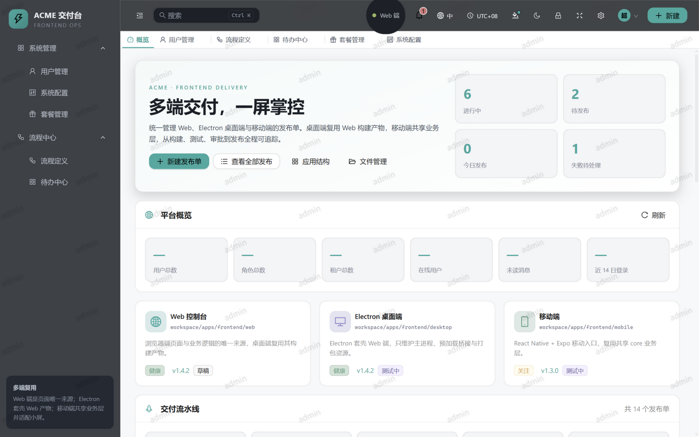
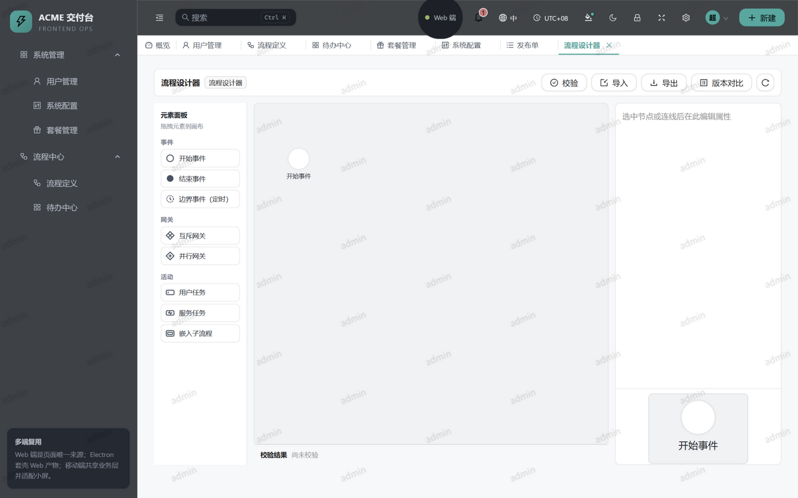
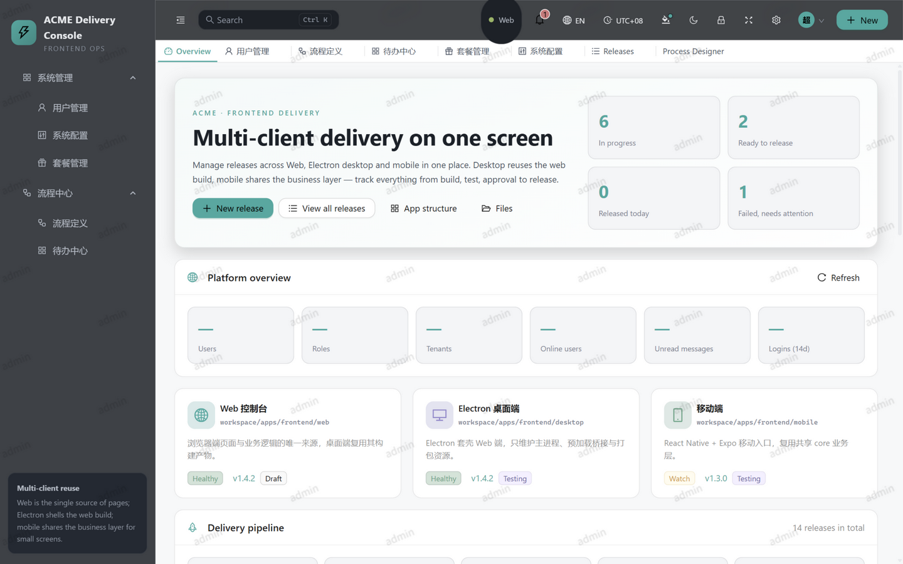
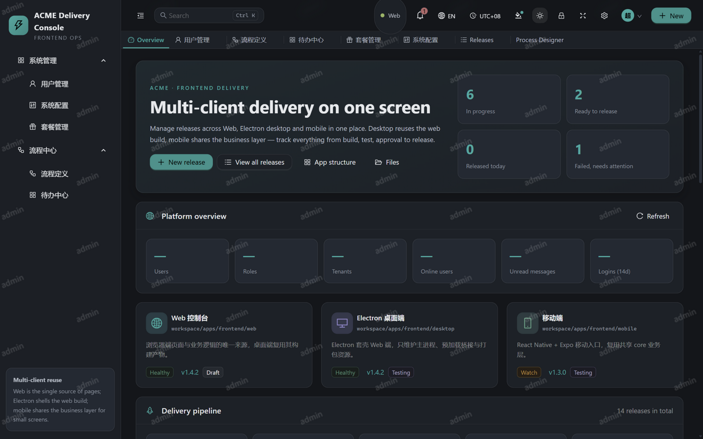

# ACME · 多端交付台 / Frontend Delivery Console

> **中文**：ACME 是一套多租户、多端协同的软件交付与运维平台。统一维护 Web、Electron 桌面端与移动端的多端基座（共享 core、租户身份与权限体系），内置 BPM 工作流审批、任务调度、组织权限与审计体系；仓库同时维护一套「单一事实源、一条命令派生」的 AI Coding 配置体系。
>
> **English**: ACME is a multi-tenant delivery and operations platform. It maintains one foundation across Web, Electron desktop and mobile (shared core, tenant identity and RBAC), with built-in BPM approvals, job scheduling, audit trails — plus a single-source, one-command-sync AI Coding configuration system.



<p align="center"><i>概览：平台数据、多端基座与快捷入口 / Overview: platform data, multi-client foundation and quick access</i></p>

## 目录 / Contents

- [简介 / Overview](#简介--overview)
- [核心能力 / Highlights](#核心能力--highlights)
- [效果图 / Screenshots](#效果图--screenshots)
- [技术栈 / Tech Stack](#技术栈--tech-stack)
- [目录结构 / Repository Layout](#目录结构--repository-layout)
- [快速开始 / Quick Start](#快速开始--quick-start)
- [文档导航 / Documentation](#文档导航--documentation)
- [AI Coding 配置体系 / AI Coding Config](#ai-coding-配置体系--ai-coding-config)

## 简介 / Overview

**中文**：ACME 不是单纯的演示项目，而是可真实部署的全栈应用。前端以 Web 端为页面唯一来源，Electron 复用其构建产物，移动端共享 `@acme/core` 业务层；后端为 Java 25 / Spring Boot 4.1 多模块服务，通过统一网关对接；部署栈基于两台云机上的 k3s，CI 负责门禁、脚本负责本地构建与上线。平台面向多租户场景，提供租户/套餐、用户/角色/权限、流程定义与待办、调度任务、审计日志、文件与实时通知等完整能力。

**English**: ACME is a deployable full-stack product, not a toy demo. The Web console is the single source of pages; Electron wraps the same web build; mobile shares the `@acme/core` business layer. The backend is a Java 25 / Spring Boot 4.1 multi-module service suite behind a unified gateway, deployed on a two-node k3s cluster. It covers multi-tenancy and packages, users/roles/permissions, BPM definitions and todos, scheduled jobs, audit logs, file storage and real-time notifications.

## 核心能力 / Highlights

| 能力 / Capability | 说明（中文） | English |
|---|---|---|
| 多端基座 / Multi-client foundation | Web 为页面唯一来源，Electron 复用 Web 构建产物，移动端共享 `@acme/core` 业务层与租户身份 | Web is the single source of pages, Electron reuses the web build, and mobile shares the `@acme/core` business layer and tenant identity |
| BPM 工作流 / Workflow | 可视化流程设计器（BPMN XML、校验、导入导出、版本对比、部署）与待办中心（认领、转办、加签、完成、驳回） | Visual BPMN designer (validation, import/export, version diff, deploy) and a todo center with claim, transfer, delegate, complete and reject |
| 调度中心 / Scheduler | 任务定义、执行历史、执行器监控；支持 cron / fixed-rate / once 与手动触发 | Job definitions, execution history and executor monitoring; cron / fixed-rate / once schedules plus manual triggers |
| 多租户与权限 / Tenancy & RBAC | 三级租户层级、套餐与配额、用户/角色/菜单/数据范围、按钮级权限码、动态导航 | Three-level tenant hierarchy, packages and quotas, users/roles/menus/data scope, button-level permission codes and dynamic navigation |
| 审计与安全 / Audit & security | 审计事件、登录日志、在线用户、异常日志、水印、锁定屏幕、验证码策略与扫码登录 | Audit events, login logs, online users, exception logs, watermark, screen lock, captcha policies and QR-code login |
| 实时通知 / Notifications | 公告发布、站内信未读角标、REST + 同源 WebSocket 实时推送 | Announcements, unread inboxes and real-time delivery over REST plus same-origin WebSocket |
| 个性化 / Personalization | 中英文切换、明暗主题/强调色/密度、时区与日期格式、命令面板（Ctrl+K）、页签保持 | zh-CN / en-US locales, light / dark themes, accent and density, timezone and date format, command palette (Ctrl+K) and keep-alive tabs |
| AI Coding 配置 / AI config | `.ai/` 唯一事实源，一条命令派生到 Claude Code / Cursor / Copilot / Codex / Gemini / CodeBuddy / Trae / Qoder / ZCode 等 | Single source in `.ai/`, synced to Claude Code, Cursor, Copilot, Codex, Gemini, CodeBuddy, Trae, Qoder, ZCode and other `AGENTS.md` consumers |

## 效果图 / Screenshots

> 截图来自本地 `pnpm dev` + MSW mock 数据的真实页面渲染（非设计稿）。
> Captured from real page renders on local `pnpm dev` with MSW mock data — not design mockups.

### 概览（中文） / Dashboard (Chinese)


### BPM 流程设计器 / BPM Process Designer



### 英文界面 / English UI



### 深色主题 / Dark Theme



## 技术栈 / Tech Stack

| 层次 / Layer | 技术 / Technology |
|---|---|
| 前端 Web | TypeScript 5、React 18、Vite 5、Ant Design 5、Zustand、React Router、Tiptap、ECharts、AntV X6、dnd-kit、i18next、MSW |
| 桌面 / Desktop | Electron 37 + electron-updater / builder，`acme://` 协议加载 Web 产物 |
| 移动端 / Mobile | React Native 0.76 + Expo 52 + React Navigation 7，共享 `@acme/core` |
| 后端 / Backend | Java 25、Spring Boot 4.1、Spring Cloud 2025.1、MyBatis-Flex、PostgreSQL、Redis、Kafka、Nacos、WebFlux 网关 |
| 部署 / Deployment | Docker 多阶段构建、k3s（server + agent 两节点）、Kustomize base / prod / monolith、Traefik、MinIO、本地构建脚本 + SSH 部署 |
| 质量门禁 / Gates | Vitest / node:test、Maven test、TypeScript 类型检查、`node .ai/sync.mjs --check`、GitHub Actions |

后端服务端口：网关 9888、platform-auth 9882、platform-system 9881、platform-infra 9880、platform-workflow 9883、platform-scheduler 9884；单体打包 9680。
Backend ports: gateway 9888, platform-auth 9882, platform-system 9881, platform-infra 9880, platform-workflow 9883, platform-scheduler 9884; monolith 9680.

## 目录结构 / Repository Layout

```text
acme/
├── README.md / .gitignore / .gitattributes        # 项目说明与工程配置 / project docs & git config
├── AGENTS.md  CLAUDE.md  GEMINI.md  CODEBUDDY.md   # ⚙️ 引用存根 → .ai/RULES.md / import stubs
├── .ai/                          # ★ AI 配置唯一事实源 / single source of truth for AI config
├── .ai-memory/                   # 决策 / 手册 / 草稿 / decisions, playbooks, drafts
├── .ai-tmp/                      # AI 临时区（内容不入库）/ ignored scratch space
├── docs/                         # 项目设计文档与截图 / design docs and screenshots
│   └── screenshots/              # README 效果图 / README screenshots
├── workspace/
│   ├── apps/frontend/            # pnpm monorepo: core / web / desktop / mobile
│   ├── apps/backend/             # Java 25 多模块 Maven 工程 / multi-module Maven backend
│   ├── env-stack/                # k8s manifests、部署脚本 / k8s manifests and deploy scripts
│   └── ui-prototype/             # 已归档的 UI 原型专区 / archived UI prototype zone
└── .claude/ .cursor/ .gemini/ .trae/ .qoder/ .github/   # ⚙️ 全部为生成产物 / generated only
```

## 快速开始 / Quick Start

**中文**：前端开发默认启用 MSW mock，无需后端即可体验完整界面；需要联调真实后端时关闭 mock 并确保网关运行在 `http://localhost:9888`。

**English**: The web dev server enables MSW mocks by default, so the full UI works without a backend. To connect a real backend, disable mocks and run the gateway at `http://localhost:9888`.

```bash
# 前端 / Frontend (Node >= 22.13, pnpm 11.8)
cd workspace/apps/frontend
pnpm install
pnpm dev                       # http://localhost:5173
# VITE_ENABLE_MSW=false pnpm dev   # 联调真实后端 / use real API

# 后端 / Backend (Maven 需在 PATH；集成测试需 Docker)
cd workspace/apps/backend/acme-cloud
mvn test

# 门禁 / Gates
cd workspace/apps/frontend && pnpm typecheck && pnpm test && pnpm build
cd workspace/apps/backend/acme-cloud && mvn -B test
```

**开发工作树 / Development worktree**：所有会产生提交的任务先在独立工作树进行（主工作树只做合并与推送）。
**All committing work starts in a dedicated worktree**; the main worktree is reserved for merges and pushes.

```bash
node .ai/worktree.mjs add feat/<简述>
# 完成后 / when done: node .ai/worktree.mjs remove feat/<简述>
```

## 文档导航 / Documentation

| 想了解 / Looking for | 阅读 / Read |
|---|---|
| 前端三端与命令 / Frontend stack & commands | [workspace/apps/frontend/FRONTEND.md](workspace/apps/frontend/FRONTEND.md) |
| 后端模块与端口 / Backend modules & ports | [workspace/apps/backend/BACKEND.md](workspace/apps/backend/BACKEND.md) |
| 环境搭建与部署 / Environments & deployment | [workspace/env-stack/ENV-STACK.md](workspace/env-stack/ENV-STACK.md) |
| 工作流引擎设计 / BPM engine design | [docs/bpm-engine-design-2026-11-21.md](docs/bpm-engine-design-2026-11-21.md) |
| 调度中心设计 / Scheduler design | [docs/scheduler-center-design-2026-11-21.md](docs/scheduler-center-design-2026-11-21.md) |
| AI 工具分教程 / Per-tool tutorials | [.ai/TUTORIAL.md](.ai/TUTORIAL.md) |
| 让 AI 自维护 / AI self-maintenance prompts | [.ai/PROMPTS.md](.ai/PROMPTS.md) |
| 使用指南与排障 / Guide & troubleshooting | [.ai/GUIDE.md](.ai/GUIDE.md) |
| 派生体系与新增工具 / Architecture & new tools | [.ai/ARCHITECTURE.md](.ai/ARCHITECTURE.md) |

## AI Coding 配置体系 / AI Coding Config

**中文**：所有 AI-Coding 内容（规范、分层规则、agents/skills/commands 公共池、工具配置、git 钩子、CI）只在 `.ai/` 下维护，其余位置全部是派生文件或引用存根。改动后必须运行 `node .ai/sync.mjs`；`node .ai/sync.mjs --check` 由 pre-commit 与 CI 双重校验。

**English**: All AI Coding content (rules, layered guidance, agent/skill/command pools, tool configs, git hooks and CI) is maintained only under `.ai/`; everything else is generated or an import stub. After changes run `node .ai/sync.mjs`; `node .ai/sync.mjs --check` is enforced by both pre-commit hooks and CI.

| 厂商 / Vendor | 工具 / Tool | 入口 / Entry |
|---|---|---|
| Anthropic | Claude Code | `CLAUDE.md` + `.claude/` |
| Anysphere | Cursor | `.cursor/rules/*.mdc` + `AGENTS.md` |
| GitHub | Copilot | `.github/copilot-instructions.md` |
| OpenAI | Codex | `AGENTS.md` |
| Google | Gemini CLI / Antigravity | `GEMINI.md` + `.gemini/` |
| 腾讯 / Tencent | CodeBuddy | `CODEBUDDY.md` |
| 字节 / ByteDance | Trae | `.trae/rules/project_rules.md` |
| 阿里 / Alibaba | Qoder | `.qoder/rules/project_rules.md` |
| 智谱 / Z.AI | ZCode | `AGENTS.md` |
| 其他 / Others | Amp、Goose、OpenCode、Zed、Kimi Code、Amazon Q、Junie | `AGENTS.md` |
