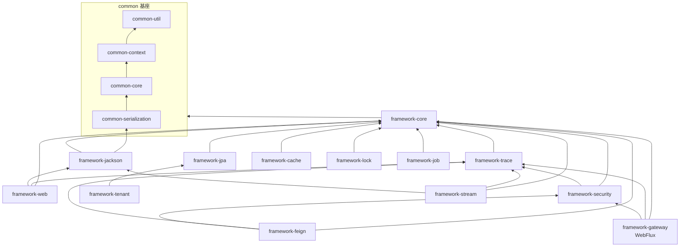

# Modules.md — common 与 framework 模块规范

版本：v1.10（2026-10-27）
技术栈基线：Spring Boot 4.x + Jackson 3.x（`tools.jackson.*`）· Spring Cloud Gateway · Nacos · Spring Cloud Stream（多 binder）· Spring Data JPA + QueryDSL · Caffeine + Redis 二级缓存 · Scheduling + ShedLock · 网关集中鉴权 · 限流/熔断统一 Resilience4j（不引入 Sentinel）

---

## 1. 总则

1.1 本文档约束 `acme-common` 与 `acme-framework` 两组模块的职责、边界、依赖与建设顺序；服务层（`platform-**` / `business-**`）规范见 `Backend.md`。

1.2 依赖只允许自下而上：`business → platform → framework → common`。任何反向依赖视为缺陷。

1.3 所有模块遵循统一约束等级：**应**（默认要求）、**宜**（推荐）、**可**（允许）、**不得**（硬禁止）。

1.4 工具库与预留：Hutool 仅限 `framework-*` 与服务层使用，`common-*` 不得引入（白名单见 Backend.md 7.1.2；与 `common-util` 职责重叠时优先 `common-util`）；`spring-ai-bom` 仅作版本基线预留，当前无承载模块，引入 AI 能力前须先补规范。

---

## 2. common 子模块（8 个）

### 2.1 模块清单

| 模块                     | 职责                                                                                                                                                                                    | 允许依赖                                                        | 必需性   |
| ---------------------- | ------------------------------------------------------------------------------------------------------------------------------------------------------------------------------------- | ----------------------------------------------------------- | ----- |
| `common-util`          | 日期、字符串、集合、加解密、ID 生成、树构建、金额辅助                                                                                                                                                          | JDK、`slf4j-api`                                             | 必须    |
| `common-context`       | `UserContext`（userId、roles，身份域）、`TenantContext`（tenantId，租户唯一事实源）、`TraceContext`（traceId、spanId）、`LocaleContext`、`ClientContext`（channel B/C、deviceId、appVersion）、`ContextSnapshot`、`ContextScope` | util                                                        | 必须    |
| `common-core`          | `Result<T>`、`ErrorCode`、`BizException`、`Assert`、`Money`、`Clock`、通用枚举（`YesNo`、`Enabled`）；分页基元收敛 `common-contract`（v1.7）                                                                          | util、context、`jackson-annotations`                          | 必须    |
| `common-contract`      | 跨服务协议基元：`EventEnvelope`、错误码分段约定、分页协议 `PageQuery`/`PageResult`（推荐 record，服务内与跨服务统一）；服务间业务 DTO 归各服务 `*-api`（Backend.md 9.1.1），不得放入本模块                                      | core                                                        | 微服务必选 |
| `common-serialization` | Jackson 3 `Module` 集：Long→String、时间格式与时区、枚举 code、脱敏序列化器、BigDecimal 规整；`Json` 门面                                                                                                       | `tools.jackson.core:jackson-databind`、`jackson-annotations`、core（仅供 `Json` 门面异常转换，2.5.3） | 必须    |
| `common-i18n`          | 消息资源与 `MessageSource` 抽象                                                                                                                                                              | core                                                        | 按需    |
| `common-validation`    | 自定义约束注解与 `ConstraintValidator`                                                                                                                                                        | core、`jakarta.validation-api`                               | 按需    |
| `common-test`          | 测试基类、fixture 构造器、Testcontainers 封装                                                                                                                                                    | core、测试栈（JUnit / AssertJ / Testcontainers 等；本模块为测试栈唯一 compile 载体，消费方以 test scope 引入本模块，生产打包不带入）                                            | 按需    |

### 2.2 依赖方向

```text
common-util  ←  common-context  ←  common-core  ←  common-contract
                                       ↑
                    common-i18n / common-validation / common-test
                                       ↑
                    common-serialization（仅 Json 门面异常转换，2.5.3；其余仅依赖 jackson）
```

2.2.1 `common-core` 不得依赖 `common-contract`；出现该依赖即为契约倒灌，应将共享类型下沉至 `common-core`（或其下方模块），不得反向依赖。

2.2.2 子模块集合固定，不随服务数量或业务域增减。

2.2.3 上图为允许拓扑（方向上界）；模块 pom 的实际依赖以「实际引用为准」（未用不声明），但不得超出上图方向与 2.1 允许列。

### 2.3 边界

| 维度   | 规则                                                                                                           |
| ---- | ------------------------------------------------------------------------------------------------------------ |
| 允许依赖 | 仅 `slf4j-api`、`jackson-databind`（仅 serialization）、`jackson-annotations`、`jakarta.validation-api`（Backend.md 7.1.2）；Lombok 仅限编译期，测试栈仅限测试域 |
| 不得依赖 | `spring-boot-starter-*`、`spring-web*`、ORM、Redis、MQ、HTTP 客户端、数据源、日志实现、线程池、`@Configuration`/`@Bean`/`@Service` |
| 不得出现 | 业务实体与业务名词（`User`、`Order`）；静态可变全局状态                                                                           |
| 包结构  | 对外 `com.acme.common.<module>`；实现细节放 `...internal`，模块外不得引用                                                    |
| 兼容性  | 只允许新增类与方法；破坏性改动走 major，`@Deprecated` 至少保留两个 minor                                                            |
| 准入判据 | 新增子模块须同时满足：删除全部业务代码后可独立编译并通过测试；已有 ≥ 3 个服务各写过一遍同类代码                                                           |

### 2.4 common-context 细则

2.4.1 只存值，不做解析：token 解析在 `framework-security`，请求头提取在 `framework-web`；不得查库、不得出网。

2.4.2 不得使用 `RequestContextHolder`（会引入 `spring-web`）；仅用 `ThreadLocal` / `InheritableThreadLocal`。

2.4.3 必须提供 `capture()` / `restore()` 与 `ContextScope`，覆盖线程池、MQ 消费、定时任务三类场景；请求结束必须 `clear()`（Web 层放 `finally`，异步层用 `ContextScope.close()`）。

2.4.4 `UserContext` / `TenantContext` / `ClientContext` 等身份域上下文写入源唯一且限定为受信任入口：HTTP 通道经网关注入后，仅允许 `framework-security` 在内部令牌校验通过后写入（信任时序见 3.1.2）；消息通道仅允许 `framework-stream` 消费管线依据 `ServiceHeaders` 约定头恢复写入（见 3.1.2）。`LocaleContext` 为非身份上下文：HTTP 通道由 `framework-i18n` 的 Locale 解析入口写入（BR-011），消息通道随 `ServiceHeaders` 约定头恢复（Backend.md 11.6.3）。业务代码只读。

### 2.5 common-serialization 细则

2.5.1 HTTP、Feign、MQ、Redis、WebSocket 共用同一 `Module` 集合，不得各自 `new ObjectMapper()`。

2.5.2 `JsonMapper` 由 Boot 4 自动配置或 `framework-jackson` 通过 `JsonMapperBuilderCustomizer` 装配；本模块只提供 `Module`、`ValueSerializer` / `ValueDeserializer`、`Json` 门面。

2.5.3 `Json` 门面不得抛受检异常；内部统一捕获 `JacksonException`（`tools.jackson.core`，unchecked）并转为 `BizException`。

2.5.4 不得引入 `jackson-datatype-jsr310` / `jackson-datatype-jdk8` / `jackson-module-parameter-names`（已并入 databind）；不得使用 `new ObjectMapper()`、`copy()`（改用 `rebuild()`）。

2.5.5 加签 / 验签不得依赖字段序列化顺序（Jackson 3 默认按属性名字母序）；日期一律 ISO-8601 字符串，展示格式由前端负责。

---

## 3. framework 模块（13 必选 + 9 按需）

### 3.1 必选模块

| 模块                   | 职责                                                                                                            | 直接依赖                 | 开关                      |
| -------------------- | ------------------------------------------------------------------------------------------------------------- | -------------------- | ----------------------- |
| `framework-core`     | 异步线程池 + 上下文透传装饰器、事务提交后事件发布、`ApplicationContext` 工具、自动装配基类                                                     | common               | `acme.core.enabled`     |
| `framework-jackson`  | Jackson 3 装配：`JsonMapperBuilderCustomizer` 注册 common-serialization 的 Module、`@AcmeJacksonComponent` 扫描、时间/枚举/脱敏统一 | common-serialization、core | `acme.jackson.enabled`  |
| `framework-trace`    | traceId 生成与 MDC、HTTP / Feign / Stream 三通道透传、日志 pattern                                                        | core、context、contract | `acme.trace.enabled`    |
| `framework-web`      | 统一出参包装、全局异常、校验错误映射、服务侧访问日志、`ClientContext` 解析（B/C、deviceId）                                                 | core、jackson、trace   | `acme.web.enabled`      |
| `framework-jpa`      | 审计字段填充、软删除、乐观锁、QueryDSL 装配、批量写入、慢 SQL 与绑定参数日志                                                                 | core、contract、util  | `acme.jpa.enabled`      |
| `framework-security` | 下游侧：校验内部令牌、令牌类型与端别声明校验（含刷新令牌，按端会话策略 Backend.md 11.4）、解析权限、数据权限拦截、上下文写入（信任时序 3.1.2）                                                                                  | core、trace           | `acme.security.enabled` |
| `framework-gateway`  | 网关侧（WebFlux）：按端鉴权与限流（B/C 独立策略，Backend.md 11.1.3）、剥离伪造身份头、注入内部令牌、灰度、请求日志                                                                   | core、trace、security  | `acme.gateway.enabled`  |
| `framework-tenant`   | 租户上下文 + Hibernate `@TenantId` 自动过滤 + 忽略注解 + 跨租户审计                                                             | jpa                  | `acme.tenant.enabled`   |
| `framework-cache`    | 二级缓存：Caffeine L1 + Redis L2、写时删 L2 并广播清 L1、防击穿、key 规范                                                         | core、serialization  | `acme.cache.enabled`    |
| `framework-lock`     | Redisson 分布式锁、`@DistributedLock`、看门狗租约、失败策略                                                                   | core                 | `acme.lock.enabled`     |
| `framework-stream`   | 发送门面（messageId / traceId / 租户头 / 操作人头）、消费幂等、死信重试、多 binder 路由、错误处理                                                    | core、jackson、trace、contract、serialization | `acme.stream.enabled`   |
| `framework-feign`    | 内部调用：超时、重试、熔断降级（Resilience4j）、错误解码为 `BizException`、内部令牌注入、身份 / 租户 / 端别上下文头注入、trace 透传                                                               | core、trace、security、contract | `acme.feign.enabled`    |
| `framework-job`      | ShedLock 装配（JDBC / Redis）、任务注册、执行日志、手动触发、租户锁 key                                                              | core（jpa 可选）         | `acme.job.enabled`      |

3.1.1 出参与跨域边界：标准响应体由服务侧 `framework-web` 产出（Backend.md 10.5.3），网关仅统一封装网关自身错误响应，不得对业务响应二次包装（Backend.md 11.1.1）；跨域由网关统一处理，`framework-web` 不重复配置 CORS。

3.1.2 上下文信任时序：网关剥离伪造身份头并注入身份头与内部令牌 → 下游 `framework-security` 校验内部令牌通过后方可写入 `UserContext` / `ClientContext` / `TenantContext` → `framework-web` 仅做头提取与绑定，不做信任决策；未经 security 校验的请求（直连、公开端点）不得写入上下文（M-10、Backend.md 11.6.2）。服务间与消息侧的上下文透传由 `framework-feign` / `framework-stream` 注入约定头（11.6.3）；消息消费侧由 `framework-stream` 消费管线依据约定头恢复写入 `UserContext` / `ClientContext` / `TenantContext` / `LocaleContext` 并于消费结束清理，其信任边界为内部 MQ 基础设施（13.2），不经 security 校验环节（M-10 针对 HTTP 身份头场景）。

3.1.3 限流 key 规范：B 端维度为「账号 + 接口」，C 端维度为「设备 + 用户 + 接口」（Backend.md 11.4）；key 由 `framework-gateway` 与 `framework-ratelimit` 统一构造，带服务前缀与端别标识（12.3.2），业务代码不得自造限流键。

### 3.2 按需模块

| 模块                        | 职责                              | 直接依赖            | 引入时机             |
| ------------------------- | ------------------------------- | --------------- | ---------------- |
| `framework-idempotent`    | HTTP token 与 MQ messageId 双入口幂等 | core、web、stream | 存在下单 / 支付等幂等写接口  |
| `framework-excel`         | 导入导出                            | web             | 有报表需求            |
| `framework-i18n`          | Locale 解析与 MessageSource 装配     | core、context、contract、common-i18n | 需要多语言            |
| `framework-audit`         | 操作审计埋点（注解 + 事件，落库在 platform）    | web              | 需要审计             |
| `framework-storage`       | 对象存储（MinIO / OSS）适配             | core            | 需要文件存储           |
| `framework-doc`           | OpenAPI 聚合（springdoc）           | web             | 需要接口文档           |
| `framework-ratelimit`     | 服务侧 Redis 令牌桶限流           | core            | 需要资源级限流而网关策略不足时 |
| `framework-observability` | Micrometer + OTel 导出、RED 指标     | trace           | 接入可观测平台          |
| `framework-tx`            | Seata 装配：事务分组、失败回滚策略、超时预算（版本随 spring-cloud-alibaba BOM；强一致使用需架构评审，Backend.md 10.2.4） | core            | 经架构评审使用强一致分布式事务时 |

不建议默认创建：`framework-sso-client`（第三方登录收敛在 `platform-auth` 内实现）、`framework-nacos`（官方 starter 够用，配置加密与命名空间约定写入规范即可）。

### 3.3 依赖分层

```text
第 1 层  framework-core
第 2 层  framework-trace · framework-jackson · framework-jpa
第 3 层  framework-web · framework-security · framework-tenant
         framework-cache · framework-lock · framework-stream · framework-job
第 4 层  framework-feign（依赖 security）· framework-gateway（仅网关应用引用）
```

3.3.1 同层模块之间不得互相依赖；若出现共享需求，应将公共部分下沉到 `framework-core`。按需模块（3.2）置于其直接依赖所在最高层之上（如 `framework-idempotent` 位于第 4 层）。

3.3.2 `framework-gateway` 为 WebFlux，`framework-web` 为 Servlet：两者不得互相依赖，Boot 4 下混引会导致 MVC 自动配置失效。

3.3.3 framework 不得依赖任何 `platform-**` / `business-**` 模块。

### 3.4 依赖关系图

> 细粒度直接边以 3.1 表为准（含 common 侧 context/contract/util/serialization 等实边，v1.6→v1.7 登记）；本图仅表达分层骨架。



### 3.5 边界

| 维度           | 规则                                                                                                            |
| ------------ | ------------------------------------------------------------------------------------------------------------- |
| 模块形态         | 每个 starter 必备三包：`config`（`@AutoConfiguration` + `*Properties`）、`support`、`internal`；有拦截/切面时置 `interceptor` / `aspect`，无则不设空壳占位包（v1.7） |
| 可关闭性         | 每个模块必须可通过 `acme.<name>.enabled=false` 完全关闭，关闭后行为与未引入一致                                                        |
| 自动装配         | 通过 `META-INF/spring/org.springframework.boot.autoconfigure.AutoConfiguration.imports` 注册                      |
| 依赖粒度         | 依赖 Boot 4 细粒度模块（如 `spring-boot-jackson`、`spring-boot-data-jpa`），不得引入大而全 starter                               |
| Jackson 2 共存 | 不得引入 `spring-boot-jackson2`；第三方 SDK 需要 Jackson 2（如 jjwt-jackson、Redisson 编解码）时隔离在对应 `framework-*` 模块的 `internal` 或 `framework-*-adapter`，不得注册 Jackson 2 `Module`，common 与 business 不接触             |
| 数据边界         | framework 不建业务表；ShedLock 锁表、幂等记录表等基础设施表的 DDL 模板由 platform-infra 维护，使用方服务在**自有 schema** 建同名表（Backend.md 12.1.1），不得跨服务共享（M-03）                                                      |


---

## 4. 开发顺序

| 批次     | 内容                                                                                               | 前置       | 完成后的验收标准                                                                    |
| ------ | ------------------------------------------------------------------------------------------------ | -------- | --------------------------------------------------------------------------- |
| P0 基座  | common-util → common-context → common-core → common-serialization（i18n / validation / test 按需同步） | 无        | `mvn install` 通过；serialization Module 在纯 JUnit 下验证 Long→String、脱敏、时间格式      |
| P1     | framework-core                                                                                   | P0       | 异步线程池透传上下文不丢；事务提交后事件发布生效                                                    |
| P2 横切  | framework-trace、framework-jackson（可并行）                                                           | P1       | HTTP 请求 MDC 含 traceId；注入的 JsonMapper 序列化结果符合规范                              |
| POC 门禁 | QueryDSL × Hibernate 7（JPA 3.2）、Spring Cloud Alibaba × Boot 4 版本线、Stream 多 binder 路由             | —        | 三项全部通过才允许进入 P3；QueryDSL 受阻改用 Spring Data Specification，`framework-jpa` 设计不变 |
| P3 接入  | framework-web、framework-jpa、framework-security、framework-gateway（4 个可并行）                         | P2 + POC | 网关→示例服务跑通：网关验签注入内部令牌、下游校验、统一出参、CRUD + QueryDSL 查询                           |
| P4 能力  | framework-tenant、cache、lock、stream、feign、job（6 个可并行）                                             | P3       | 双实例验证缓存失效广播、ShedLock 互斥、MQ 收发带 traceId、feign 注入令牌；各开关关闭后行为不变                |
| P5 按需  | idempotent、excel、i18n、audit、storage、doc、ratelimit、observability、tx                                  | 各自对应模块   | 随业务需求引入，不阻塞主链路                                                              |

4.1 POC 门禁位于 P2 与 P3 之间：`trace` / `jackson` / `core` 与风险无关可先产出；`jpa`（QueryDSL）与 `stream`（binder）直接踩在风险上，门禁通过后再动手。

4.2 `framework-gateway` 自 P3 起独立开发与部署，禁止引入任何 Servlet 依赖。

4.3 P4 内部若发现需要互相调用（如 lock 被 cache 引用），应将共享部分下沉到 `framework-core`，不得新增横向依赖。

---

## 5. 高频归属速查

> 下表中 `platform-auth` / `platform-infra` 为示例名，实际服务清单以拆分评审为准（Backend.md 1.3、5.3.1）。

| 组件                                | 归属                                            |
| --------------------------------- | --------------------------------------------- |
| `UserContext` / `TraceContext` 持有 | `common-context`                              |
| `Json` 门面、脱敏序列化器                  | `common-serialization`                        |
| `Result` / `ErrorCode` / `Money`  | `common-core`                                 |
| 跨服务协议基元（信封 / 分页 / 错误码分段）      | `common-contract`（服务间业务 DTO 归 `*-api`）    |
| token 解析                          | `framework-security`（校验）/ `platform-auth`（签发） |
| 短信通道适配 / 模板与频控                    | `framework-*`（通道）/ `platform-infra`（运营）       |
| 幂等组件 / 幂等键定义                      | `framework-idempotent` / 业务服务                 |
| 审计埋点 / 审计落库与查询                    | `framework-audit` / `platform-infra`          |
| ShedLock 锁表                       | DDL 模板 `platform-infra` / 使用方服务自有 schema 建表（framework-job 只管装配）          |

---

## 6. 修订记录

| 版本 | 日期 | 修订说明 |
| --- | --- | --- |
| v1.0 | 2026-10-18 | 初版 |
| v1.1 | 2026-10-18 | 一致性修订：与 Backend.md v2.3 对齐——「跨服务 DTO」改称跨服务协议基元、业务 DTO 归 `*-api`（2.1、5）；新增 3.1.1 划定出参包装/CORS 边界，framework-web 移除 CORS；common 白名单对齐 7.1.2（2.3、common-test 补测试栈）；serialization 允许依赖 core（Json 门面异常转换，2.2、2.5.3）；分层调整 feign 至第 4 层，消除同层互依（3.3）；基建表 DDL 模板与自有 schema 建表口径（3.5、5）；限流/熔断收敛 Resilience4j、去掉 Sentinel 口径（技术栈基线、3.2）；新增按需模块 `framework-tx`（3.2）；Jackson 2 隔离口径补 jjwt/Redisson 落位（3.5）；新增 1.4 工具库与预留约定；5 节示例名标注 |
| v1.2 | 2026-10-18 | 2.2.1 修正「上移」措辞为「下沉」，消除与依赖方向的歧义 |
| v1.3 | 2026-10-18 | B/C 双端基座补齐：feign 补身份/租户/端别上下文头注入、stream 补操作人头（上下文透传链贯通，11.6.3）；新增 3.1.2 上下文信任时序（M-10 落地路径）并改写 2.4.4 写入源口径；gateway 改按端鉴权限流（11.1.3）；security 补令牌类型与端别声明校验（11.4）；新增 3.1.3 限流 key 规范 |
| v1.4 | 2026-10-19 | framework-jackson 直接依赖口径修订（framework-trace-jackson 特性 Q-002 裁决、DQ-009 执行口径）：3.1 表 framework-jackson 行直接依赖改为 `common-serialization、core`（复用 framework-core 自动装配基类与开关条件）；同步 3.4 依赖图补 `FJ --> FC`；顺带校准头部版本行（原标注 v1.1，第 6 章记录已至 v1.3） |
| v1.5 | 2026-10-19 | 3.1 职责栏注解名随 WQ-001 更名同步为 @AcmeJacksonComponent，framework-trace-jackson 特性 G3a 裁决 |
| v1.6 | 2026-10-20 | P4 能力层设计裁决落实（p4-capability-layer Q-D001/Q-D003）：3.1 framework-gateway 行直接依赖补 security（内部令牌签发接缝归位 security，签发/校验同居），3.4 依赖图补 `FGW --> FSEC`；2.4.4/3.1.2 上下文写入源口径扩写消息通道（framework-stream 消费管线恢复写入并清理），消息侧信任边界明确为内部 MQ 基础设施 |
| v1.7 | 2026-10-21 | 底座整体重构同步（foundation-refactor）：① 分页基元收敛 common-contract `PageQuery`/`PageResult`（服务内与跨服务统一），删除 common-core `PageReq`/`PageResp`，2.1 更新；② `UserContext` 收敛身份域（userId、roles），tenantId 唯一事实源归 `TenantContext`（DP-006 定稿），2.1 更新；③ common-test 测试栈口径消歧（本模块为测试栈唯一 compile 载体，消费方 test 引入），2.1 更新；④ 2.2.3 新增「允许拓扑 vs 实际引用」口径（未用不声明）；⑤ 3.1 直接依赖栏登记实边（trace→context/contract、jpa→contract/util、cache→serialization、stream→contract/serialization、feign→contract），3.4 补注；⑥ 3.5 模块形态改为「config/support/internal 必备、interceptor/aspect 可选」，不设空壳占位包 |
| v1.8 | 2026-10-21 | 3.2 `framework-audit` 行直接依赖移除 jpa：Q-005 裁定本期仅埋点 + 事件出口（落库归 platform-infra 后续特性），jpa 无实边，按 v1.7 实边口径修订（p5-optional-modules G2 Q-D003 决议，2026-10-21） |
| v1.9 | 2026-10-26 | common 层 DP 挂账定稿（backend-optimize-refactor）：DP-001 失败形态统一（null→NPE、非法值→IAE、解析失败透传 JDK 异常）；DP-003 雪花时钟回拨策略（≤5ms 自旋追平、大幅显式失败）与 worker 环境注入口径；DP-005 AmountMath 四则函数集与舍入细则；DP-006 Client/Trace/LocaleContext 绑定口径与 UserContext 对齐（get() 未绑定返回 null、bind(null) 即解绑）；DP-007 Result 成功码定稿 "0"、Assert 断言项清单补全（notBlank/notEmpty/noNullElements/state）、BizException 构造校验前移；DP-010 脱敏策略集扩至 6 项（补 ID_CARD/EMAIL/BANK_CARD/CHINESE_NAME/MASK_ALL，掩码段固定宽度）；DP-011 Json 门面方法集定稿（异常转换行为已由测试锁定）；DP-013 `@InEnum` 升为正式约束（null 通过、常量集哈希索引）；DP-014 common-test 完整实现（BaseTest 业务异常断言、ContainerSupport 单例复用、FixtureBuilder 嵌套路径；pom 实引补 common-core）。以上均为模块内行为定稿与兼容扩展，2.1 职责边界不变 |
| v1.10 | 2026-10-27 | 语言上下文透传与 i18n 双语齐备收口：① `ServiceHeaders` 增 `LOCALE`（`X-Acme-Language`）透传约定头，`ContextHeaders` 出站映射补 `LocaleContext`，framework-stream 消费管线随约定头恢复 `LocaleContext`，2.4.4/3.1.2 更新（`LocaleContext` 明确为非身份上下文，HTTP 写入源为 framework-i18n 解析入口，Backend.md 11.6.3 同步）；② 3.2 framework-i18n 直接依赖改实边 `core、context、contract、common-i18n`（移除未用 web 实边，2.2.3 未用不声明口径），测试域实引各 `*Error` 模块作 Q-007 裁定 B 双语齐备性校验（FrameworkErrorI18nTest）；③ 框架汇总资源补齐全部框架错误码 zh/en 提示键（58 键），服务侧语言包统一 `_zh`/`_en` 后缀（覆盖裸 zh 查询）并补跨域借码键 platform-system-07-0001（键全局稳定口径） |
