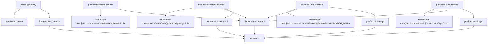

# Services.md — 部署单元与服务清单

> Backend.md 5.3.3 / 13.2.5：服务清单以清单文件形式与代码同仓维护，作为部署与容量规划的唯一依据；
> 依赖图随新增或变更调用关系同步更新（18.1.1 第 10 步）。首建于 platform-services-bootstrap（2026-10-22）。

## 1. 部署单元清单

| 部署单元 | 模块坐标 | 能力域 | 独占 schema / 存储 | 端口（本地默认） | 网关路由 | 建立来源 |
|---|---|---|---|---|---|---|
| `acme-gateway` | `com.acme:acme-gateway` | 统一接入（路由、验签、撤销检查、限流、访问日志） | 无（M-09 不直连数据库；Redis 撤销集直查 `auth:revoke:*`） | 9888 | 入口本体 | p3-access-layer（既有），本期路由追加与策略显式化 |
| `platform-auth` | `com.acme:platform-auth-api` + `platform-auth-service` | 认证（auth）：B 端登录、令牌签发、单会话互踢、登出即时失效、防爆破、凭据管理；C 端验证码登录、双令牌（access+refresh 一次性轮换）、多端并存 | `platform_auth`（PostgreSQL，含 C 端账户 `auth_consumer_account`）+ Redis（键前缀 `auth:`，含验证码 `auth:captcha:*`） | 9882 | `Path=/admin/v1/auth/**` 与 `Path=/app/v1/auth/**` → `lb://platform-auth` | platform-services-bootstrap（G2.5 评审通过）；C 端增补 consumer-auth-refresh-dataperm |
| `platform-system` | `com.acme:platform-system-api` + `platform-system-service` | 系统管理（system）：用户 / 角色 / 权限点 / 菜单 / 字典 / 租户 | `platform_system`（PostgreSQL） | 9881 | `Path=/admin/v1/system/**` → `lb://platform-system` | platform-services-bootstrap（G2.5 评审通过） |
| `platform-infra` | `com.acme:platform-infra-api` + `platform-infra-service` | 基础设施运营（infra）：审计事件 MQ 消费落库 + B 端审计查询；基础设施表 DDL 模板维护 | `platform_infra`（PostgreSQL）+ Redis（stream 消费去重）+ Kafka（主题 `infra-audit-events` / 死信 `infra-audit-events-dlq`） | 9880 | `Path=/admin/v1/infra/**` → `lb://platform-infra` | platform-infra-audit（4.3.7 拆分评审） |
| `business-content` | `com.acme:business-content-api` + `business-content-service` | 内容域（content）：内容读侧消费（feed/内容库/搜索/详情/热搜/分类）+ B 端管理（分页/改题/流转/批量下线/软删/作者候选） | `business_content`（PostgreSQL，含 `biz_content` / `biz_content_category` / `biz_hot_search_word`） | 9883 | `Path=/app/v1/contents/**,/app/v1/feeds,/app/v1/hot-searches,/app/v1/search/**,/app/v1/categories` 与 `Path=/admin/v1/contents/**,/admin/v1/categories` → `lb://business-content` | business-api-integration（G2.5 拆分评审通过） |

## 2. 服务能力与对外接口面

| 服务 | 对外接口（B 端 /admin） | 服务间接口（/internal，不经网关） |
|---|---|---|
| `platform-auth` | `POST /admin/v1/auth/tokens`（公开）、`DELETE /admin/v1/auth/tokens/current`、`PUT /admin/v1/auth/credentials/users/{userId}/password`；C 端（consumer-auth-refresh-dataperm）：`POST /app/v1/auth/captcha`（公开）、`POST /app/v1/auth/tokens`（公开）、`POST /app/v1/auth/tokens/refresh`（公开）、`DELETE /app/v1/auth/tokens/current` | 无（本期无消费方） |
| `platform-system` | `/admin/v1/system/**`（users / roles / permissions / menus / dict-types / dict-items / tenants / me；租户开通初始化 `POST /admin/v1/system/tenants/init`——建租户+默认授权+初始管理员一个事务，管理员密码经凭据端点二步设置） | `GET /internal/v1/auth-profiles`（登录画像，停用级联：用户或所属租户停用即 DISABLED）、`GET /internal/v1/authorization/permissions/{code}`（权限判定） |
| `platform-infra` | `GET /admin/v1/infra/audit-events`（审计事件分页查询；数据权限两级：具备 `infra:audit:list:all` 全租户视图，否则本人视图） | 无（消费侧为 MQ 订阅，非同步接口） |
| `business-content` | `GET /admin/v1/contents`、`PATCH /admin/v1/contents/{contentId}/title`、`PUT /admin/v1/contents/{contentId}/status`、`POST /admin/v1/contents/batch`（action=offline/delete）、`GET /admin/v1/contents/authors`、`GET /admin/v1/categories`（均需认证 + 权限点 `content:content:*`，批量按动作取权限点）；C 端公开读（Q-12=A）：`GET /app/v1/feeds`、`/app/v1/hot-searches`、`/app/v1/contents`、`/app/v1/contents/{contentId}`、`/app/v1/search`、`/app/v1/search/suggestions`、`/app/v1/categories` | 无（消费方为 platform-system 的 `/internal/v1/authorization/permissions/{code}`） |
| `acme-gateway` | 南北向流量入口；公开豁免最小集 `/admin/v1/auth/tokens` | — |

## 3. 依赖边（编译期与运行期）

- 服务间同步依赖边：`platform-auth → platform-system`（登录画像 / 凭据管理权限判定）、`platform-infra → platform-system`（审计查询权限判定）、`business-content → platform-system`（B 端权限判定）——均仅经 `platform-system-api`（4.4.2 / M-02）；`platform-system` 不依赖其余服务任何模块，无循环（M-06）。
- 异步事件边（13.2.5）：`各服务（含 platform-infra 自身）--审计事件 EventEnvelope{v1}--> Kafka 主题 infra-audit-events --> platform-infra 消费组`；发布桥接为服务侧 `AuditEventSink` 实现（参考实现见 platform-infra-service internal/mq）。
- 同步调用链深度（13.2.1 / M-07，含网关）：网关→system = 2；网关→auth→system = 3；网关→infra→system = 3；网关→content→system = 3（B 端写/管理权限判定；C 端公开读链 网关→content = 2）——均压线合规。

## 4. 基础设施登记

| 依赖 | 用途 | 归属 |
|---|---|---|
| Nacos | 注册与配置中心（配置标识 = 服务名） | 全部四个部署单元 |
| PostgreSQL（`.dev-stack`） | `platform_auth` / `platform_system` / `platform_infra` / `business_content` 独立 schema；本地建库脚本 `backend/dev-init/` | 四个平台与业务服务 |
| Redis（`.dev-stack`） | 防爆破计数 / 锁定、单会话索引、撤销集（`auth:*`）；网关撤销检查直查；infra stream 消费去重 | platform-auth（写）、acme-gateway（读）、platform-infra（读） |
| Kafka（`.dev-stack`） | 审计事件主题 `infra-audit-events` / 死信 `infra-audit-events-dlq`（13.2.2） | platform-infra（消费；发布方为埋点服务） |

## 5. 变更登记

| 日期 | 特性 | 变更 |
|---|---|---|
| 2026-10-22 | platform-services-bootstrap | 首建清单：acme-gateway（既有，路由追加与撤销检查对接）+ platform-auth + platform-system（G2.5 评审通过，首批两平台服务，M-15） |
| 2026-10-26 | backend-optimize-refactor | 端口登记勘误：本地默认端口以各服务 `application.yml` 为准修正为 gateway 9888 / platform-auth 9882 / platform-system 9881（原 8080/8081/8082 为清单笔误） |
| 2026-10-26 | platform-infra-audit | 增补第三平台服务 platform-infra（审计事件消费落库 + 查询；4.3.7 拆分评审）：部署单元 / 接口面 / 依赖边（infra→system-api、MQ 订阅边）/ 基础设施（+Kafka）登记；网关路由追加 `/admin/v1/infra/**` |
| 2026-10-26 | consumer-auth-refresh-dataperm | C 端认证落地：platform-auth 增 C 端验证码登录 / 双令牌一次性轮换 / 多端并存（11.4），网关追加 `/app/v1/auth/**` 路由与 C 端公开豁免集，C 端逻辑租户保留值 `consumer`；framework-security 数据权限机制在 platform-infra 审计查询落地（`infra:audit:list:all` 两级视图，system V4 种子）；dev-init 补登 platform_infra schema（前特性遗漏修补） |
| 2026-10-26 | tenant-management-complete | 多租户管理收口：① 停用租户登录级联（画像状态归一 DISABLED，auth 零改动映射）；② 租户开通初始化编排 `POST /admin/v1/system/tenants/init`（建租户 + tenant_admin 默认授权[平台保留域 system:tenant:* / infra:audit:* 除外] + 初始管理员，目标租户上下文绑定写入；管理员密码二步经凭据端点）。租户配额/套餐等运营能力不做（按需，无消费方） |
| 2026-10-27 | repo-cleanup | 清理自包含验证工程 `backend/poc/`、`backend/sample/`、`backend/p4-sample/`、`backend/p5-sample/`（不挂 acme-cloud、不入服务清单，P3–P5 与 POC 验收链路遗留）与 `.ai-coding/` 全部特性过程产物；本清单不涉服务增删，仅清除历史行「建立来源」中指向已删 `.ai-coding` 目录的路径引用（保留特性名与条款号） |
| 2026-10-27 | business-api-integration | 增补首个业务服务 business-content（内容域读侧消费 + B 端管理闭环；G2.5 拆分评审通过，18.1.1）：部署单元 / 接口面（13 接口，C 端公开读 Q-12=A）/ 依赖边（content→system-api 权限判定，调用链压线 3）/ 基础设施（+`business_content` schema）登记；网关路由追加 `/app/v1/contents/**` 等与 `/admin/v1/contents/**`、`/admin/v1/categories`，C 端公开豁免最小集追加 5 条；platform-system V5 种子（内容域权限点 5 条 + 演示账号 demo_admin/demo_operator）、platform-auth V4 演示凭据（placeholder 注入，密码不落仓库） |
| 2026-10-28 | role-tree | platform-system 角色支持父子关系树状定义（纯组织层级，不改变授权语义）：`sys_role` 增 `parent_id`（V6 迁移，根哨兵 0、存量归根，sys_menu 同款 TreeBuilder 组装）；接口面增 `GET /admin/v1/system/roles/tree`，AdminRoleCreate/Update 增 parentId（调整父角色：内置拒绝、沿父链防环 ROLE_PARENT_CYCLE=02-0004 / ROLE_REPARENT_DENIED=02-0005），AdminRoleView 增 parentId/children（DTO 均为新增可选字段，9.3.2 兼容）；存在子角色拒绝删除（ROLE_DELETE_DENIED 语义扩展）；admin_console 角色页同步（上级角色树选择器 + 父级列） |
